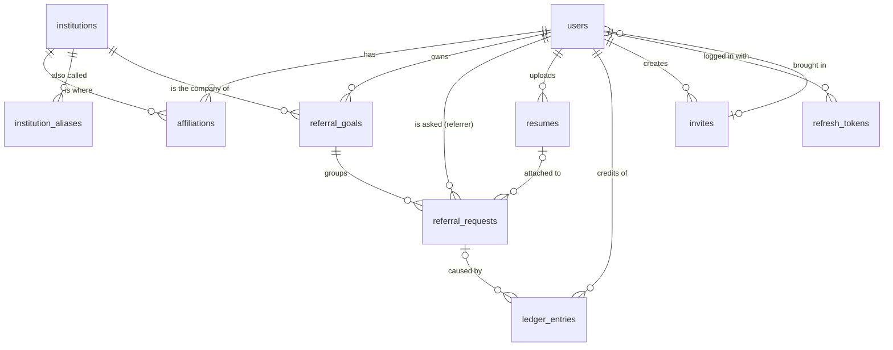
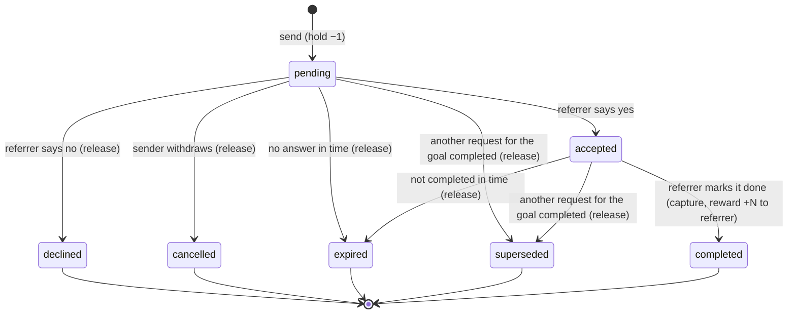

# Data model (Phase 1)

What Vouch stores, and why each piece exists. Decisions with real alternatives
have an ADR in [`docs/adr/`](../adr/).

## Principles

1. **Be lazy about speed, careful about information.** Anything that only makes
   the system faster waits until a benchmark shows the need. Anything that would
   lose data or let wrong data in gets designed now.
2. **The database enforces what it can.** Unique emails, valid states and
   non-negative sizes are constraints, so a bug in the app can't break them.
3. **Group things with a row, not by matching text.** Institutions have one
   canonical row plus aliases; requests for the same role share a goal row.

## Tables at a glance

| Table | One row is | Why it's its own table |
| --- | --- | --- |
| `users` | a person with an account | everything else points at a person |
| `institutions` | a company or a college | affiliations, aliases, matching and search treat both the same way |
| `institution_aliases` | another spelling of an institution | one institution, many spellings ("IITB", "IIT-Bombay") |
| `affiliations` | a stint: a person at an institution between two dates | one person has many stints |
| `referral_goals` | "I want a referral for this role at this company" | groups the requests for one role, so one success closes the rest |
| `referral_requests` | one ask, to one referrer, under one goal | each ask has its own state and history |
| `ledger_entries` | one credit event (grant, hold, release, capture, reward) | the balance is the sum, so every number can be explained |
| `resumes` | an uploaded file's details; the bytes live in object storage | keeps big files out of the database |
| `invites` | a short-code invite link | one link, many sign-ups, with limits |
| `refresh_tokens` | one long-lived login token | lets the server end a login |

## Common columns

- **`id uuid`**: every table's primary key, a UUIDv7 (time-ordered, not
  guessable by counting). See ADR 0004.
- **`created_at timestamptz`**: when the row was made, in UTC. `timestamptz`
  stores an exact moment, not a wall-clock reading in some unknown time zone.

## Deleting an account

Personal data goes; shared history stays. The `users` row is never removed. It
becomes a tombstone that history can still point at.

In one transaction:

| What | Happens | Why |
| --- | --- | --- |
| `users` row | kept; name becomes "Deleted user", email and password hash wiped, `deleted_at` set | other people's requests and ledger rows still point at it |
| affiliations, refresh tokens | deleted | only about Priya |
| resumes | rows deleted and files removed from object storage | personal data |
| open goals and requests (pending, accepted) | cancelled, holds released | so referrers aren't left with requests nobody will read |
| finished requests, ledger entries | kept | the referrer's history and rewards depend on them; the ledger is never rewritten |
| invites | revoked | links stop working; `invited_by` on people who joined stays |

Every foreign key uses `ON DELETE RESTRICT`: the database refuses a delete that
would leave rows pointing at nothing. Deleting is done on purpose, row by row,
in the account-deletion code. Nothing disappears as a side effect.

## Tables

### users

| Column | Type | Rules | Why |
| --- | --- | --- | --- |
| id | uuid | primary key | |
| email | text | unique, ignoring case | the login name; `Priya@x.com` and `priya@x.com` are the same person |
| password_hash | text | not null | an Argon2 hash, never the password (P1-04) |
| name | text | not null | |
| role | text | `user` or `admin` | admins resolve problems and see everything (P1-06) |
| invited_by | uuid | → invites, may be empty | which invite link brought them in |
| created_at | timestamptz | not null | |
| deleted_at | timestamptz | may be empty | set when the account is deleted (see "Deleting an account") |

### institutions

| Column | Type | Rules | Why |
| --- | --- | --- | --- |
| id | uuid | primary key | |
| name | text | not null | the canonical name, "IIT Bombay" |
| kind | text | `company` or `college` | one table for both (ADR 0005); a university can be both, so it gets one row of the kind people mostly use it as |
| created_at | timestamptz | not null | |

Kind-specific fields (industry, degree levels) get their own side table when one
is needed, not before.

### institution_aliases

| Column | Type | Rules | Why |
| --- | --- | --- | --- |
| id | uuid | primary key | |
| institution_id | uuid | → institutions | which institution this spelling means |
| alias | text | unique, ignoring case | "IITB". Unique so one spelling can't point at two places |

Typo-tolerant suggestions while typing (trigram similarity) search `name` and
`alias` together. Details in P1-08.

### affiliations

| Column | Type | Rules | Why |
| --- | --- | --- | --- |
| id | uuid | primary key | |
| user_id | uuid | → users | |
| institution_id | uuid | → institutions | |
| title | text | may be empty | "Backend Engineer", "B.Tech" |
| start_date | date | not null | |
| end_date | date | empty = ongoing; after start_date | same rule the seeder's CHECK used |

### referral_goals

| Column | Type | Rules | Why |
| --- | --- | --- | --- |
| id | uuid | primary key | |
| owner_id | uuid | → users | the job seeker |
| institution_id | uuid | → institutions, a company | |
| role_title | text | not null | "Backend Engineer" |
| job_url | text | may be empty | link to the posting |
| state | text | `open`, `referred`, `closed` | `referred` once any request completes |
| created_at | timestamptz | not null | |

### referral_requests

| Column | Type | Rules | Why |
| --- | --- | --- | --- |
| id | uuid | primary key | |
| goal_id | uuid | → referral_goals | which role this ask is for |
| referrer_id | uuid | → users | who is asked |
| message | text | not null | |
| resume_id | uuid | → resumes, may be empty | |
| state | text | one of the states below | |
| expires_at | timestamptz | not null | when it lapses if nobody acts |
| completed_note | text | may be empty | the referrer's evidence, kept for a future confirm step |
| created_at, accepted_at, completed_at, closed_at | timestamptz | set when that happens | history, and how long each step took |

Unique `(goal_id, referrer_id)`: Priya can't ask Rahul twice for the same role.
Rules the database can't check on its own (the referrer isn't the goal's owner;
the referrer works at the goal's company) are checked in the domain code.

### ledger_entries

| Column | Type | Rules | Why |
| --- | --- | --- | --- |
| id | uuid | primary key | |
| user_id | uuid | → users | whose credits |
| type | text | `grant`, `hold`, `release`, `capture`, `reward` | |
| amount | integer | sign must fit the type | grant/release/reward > 0; hold < 0; capture = 0 |
| request_id | uuid | → referral_requests, may be empty | which request caused it (empty for the sign-up grant) |
| created_at | timestamptz | not null | |

Rows are only ever added, never changed or deleted. A balance is
`SUM(amount)` for the user. A hold already took the credit away, so capture
records "this hold is now spent" with amount 0, and release gives it back
with +1.

### resumes

| Column | Type | Rules | Why |
| --- | --- | --- | --- |
| id | uuid | primary key | |
| owner_id | uuid | → users | only the owner and referrers they sent it to may read it |
| storage_key | text | unique | where the file is in object storage |
| content_type | text | `application/pdf` | |
| size_bytes | integer | > 0 and ≤ 5 MB | |
| created_at | timestamptz | not null | |

### invites

| Column | Type | Rules | Why |
| --- | --- | --- | --- |
| id | uuid | primary key | |
| code | text | unique | the `k7Qx2p` in the link |
| inviter_id | uuid | → users | |
| max_uses | integer | > 0 | limits damage if the link spreads |
| expires_at | timestamptz | not null | |
| revoked_at | timestamptz | may be empty | the inviter can kill a link |
| created_at | timestamptz | not null | |

Uses are counted from `users.invited_by`.

### refresh_tokens

| Column | Type | Rules | Why |
| --- | --- | --- | --- |
| id | uuid | primary key | |
| user_id | uuid | → users | |
| token_hash | text | unique | a hash of the token, never the token itself (P1-05) |
| family_id | uuid | not null | all tokens from one login; reuse of an old one revokes the family |
| expires_at | timestamptz | not null | |
| used_at, revoked_at | timestamptz | may be empty | used once (rotation); revoked on logout or theft |
| created_at | timestamptz | not null | |

## Referral request lifecycle

- Any move not on the diagram is refused (`409 Conflict`).
- Every request ends with exactly one release or one capture of its hold.
  Credits are spent only when the referral is delivered.
- When a request completes, in **one transaction**: it moves to `completed`,
  its goal moves to `referred`, and every other open request for that goal moves
  to `superseded` with its hold released.
- Credits never go below zero, even under concurrent requests (P1-12).

## Known risks and deferred decisions

| Item | Now | Later |
| --- | --- | --- |
| A referrer marks a referral done without making it | Trusted; `completed_note` keeps their evidence | Claim → confirm → 7-day auto-confirm → dispute to an admin |
| Two friends fake referrals to farm credits | Open | Keep the reward ≤ the cost, or cap rewards per pair; credit numbers are still open |
| Balance is summed on every read | Fine at 1k users | Stored balance next to the ledger if Phase 2 benchmarks show it's slow |
| Kind-specific institution fields | None needed | Side tables |
